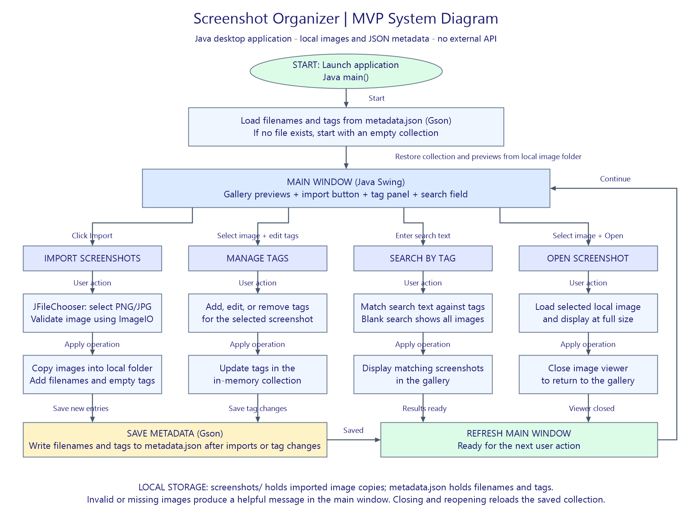

# Screenshot Organizer

A Java desktop application that helps users organize and find saved screenshots through tags and a searchable gallery.

## Project Goal

Useful screenshots often get buried in cluttered folders. This project aims to make them easier to retrieve by letting users import screenshots, assign descriptive tags, and search their collection.

## MVP Scope

- Import PNG and JPG screenshots into a local collection.
- Browse image previews in a gallery and open selected screenshots.
- Add, edit, and remove tags.
- Search and filter screenshots by tags.
- Save images and metadata locally so the collection persists between sessions.

## Future Plans

- Recognize text inside screenshots to make their contents searchable.
- Organize screenshots into named collections.
- Tag multiple screenshots at once.
- Detect duplicate screenshots during import.

## Tech Stack

- **Language:** Java
- **Interface:** Java Swing
- **File selection:** JFileChooser
- **Image handling:** ImageIO and Java image-scaling utilities
- **File management:** java.nio.file
- **Metadata:** JSON using Gson
- **Build tool:** Maven
- **Version control:** Git and GitHub

The MVP uses local files and does not require an external API or internet connection.

## Design Documents

- [Eisenhower Matrix](docs/eisenhower-matrix.pdf)
- [System Diagram Source](docs/system-diagram.drawio)

## Build Milestones

1. Set up the repository, Maven project, and Gson dependency.
2. Create the Swing application window.
3. Implement screenshot import.
4. Display the gallery and open selected images.
5. Add tag management.
6. Save and reload the collection using JSON.
7. Implement tag search.
8. Handle errors and document usage.

## Project Status

Planning and repository setup are in progress. The application is not yet implemented.